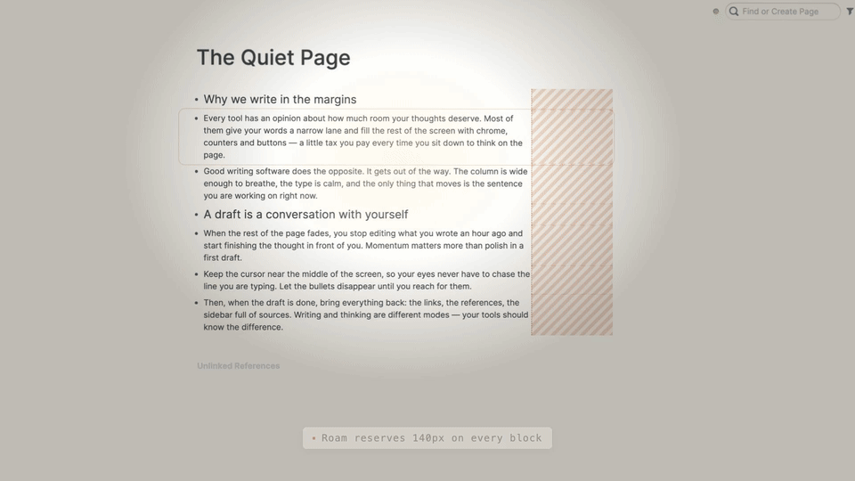
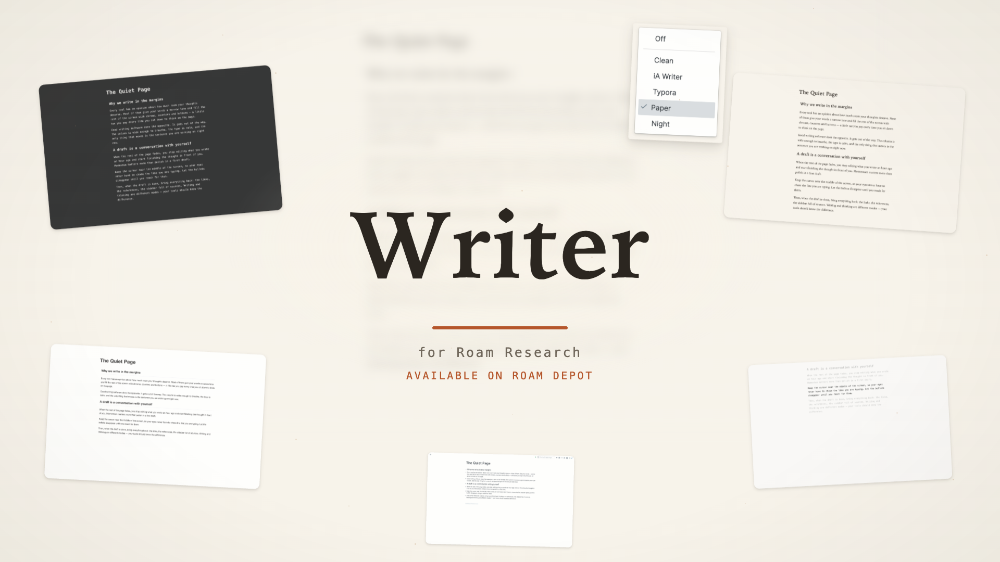
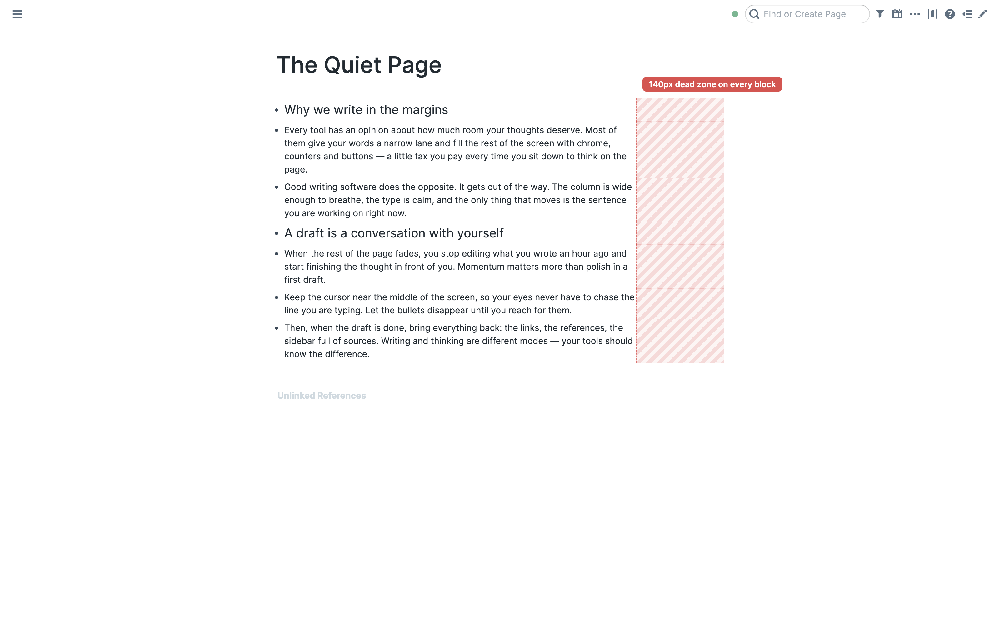
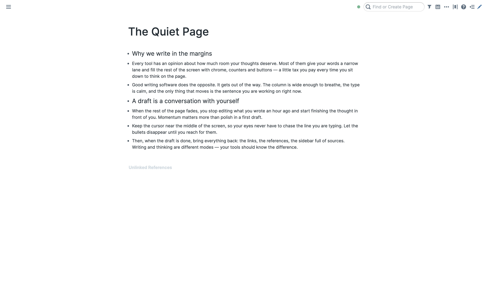
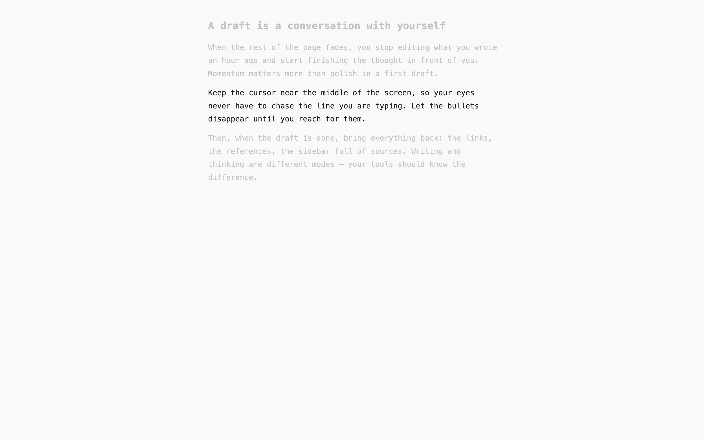
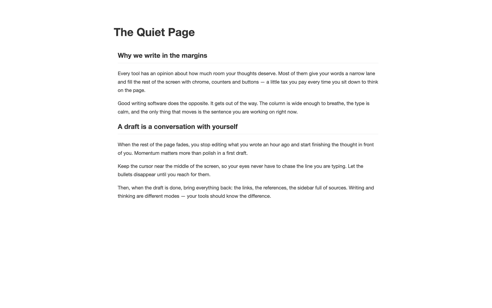
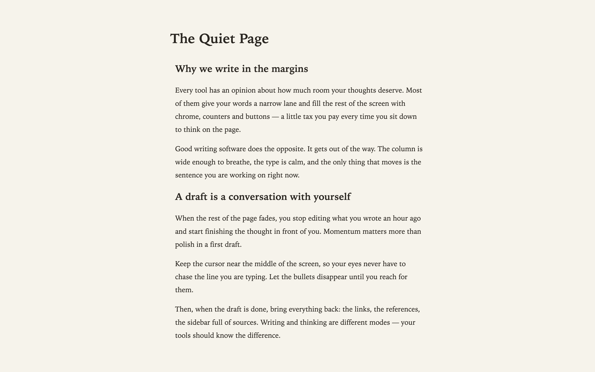
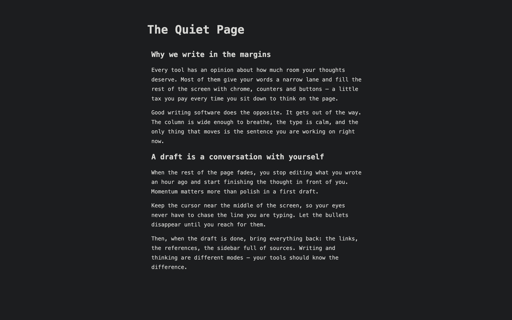
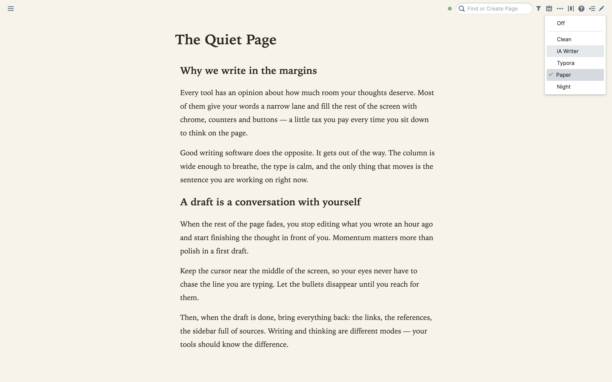

# Writer

> Write in Roam like it's the only thing on screen.

Immersive writing modes for [Roam Research](https://roamresearch.com). Writer removes the empty strip Roam reserves on the right of every block, centers your text, and gives you five writing styles inspired by iA Writer and Typora, plus paragraph focus and typewriter scrolling. Pick a mode from the ✎ button in the top bar.



[](https://github.com/qcrao/roam-writer/raw/main/assets/writer-promo.mp4)

## Why

Roam leaves a **~140px dead zone on the right of every block**. Each block row has a spacer with `min-width: 116px` plus a 24px trailing slot, so your text never reaches the edge of its own column, and the article is capped at 800px. The page feels lopsided, and long paragraphs wrap earlier than they need to.



Writer gives that space back and lets you choose how your page looks while you write.

## Modes

| Mode | Look | Focus | Typewriter | Immersive |
| --- | --- | :---: | :---: | :---: |
| **Clean** | Roam as-is, minus the dead zone; centered column | | | |
| **iA Writer** | Monospace, ~66 characters per line, blue caret | ✓ | ✓ | ✓ |
| **Typora** | Sans-serif, GitHub-style headings with underlines | | | ✓ |
| **Paper** | Serif type on warm paper, larger text for long-form writing | ✓ | | ✓ |
| **Night** | Dark iA-style theme for writing at night | ✓ | ✓ | ✓ |

**Clean**: same Roam, full-width text



**iA Writer**: while you edit, everything except the current paragraph fades, and the line you're typing stays near the middle of the screen



**Typora**



**Paper**



**Night**



## Features

- **Focus**: while you edit, every block except the current one is dimmed. This works per block (paragraph). Roam's editor is a plain textarea, so highlighting a single sentence isn't possible.
- **Typewriter scrolling**: the line with the caret (not the whole block) stays at ~45% of the screen height.
- **Immersive**: closes any open left/right sidebar when you enter (and reopens them when you leave), hides linked references, and fades the top bar until you hover it. A sidebar you open on purpose while writing (Shift+click) stays open.
- **Hidden bullets**: bullets and indent guides appear on hover only, so collapse, drag and zoom still work.
- You can override each feature per mode, plus font size and line width, in **Settings → Writer**.

## Usage



- **Top bar ✎ button**: opens the mode menu (Off / Clean / iA Writer / Typora / Paper / Night). Press Esc or click outside to close it.
- **Command Palette**: `Writer: Toggle writing mode`, `Writer: Next mode`, `Writer: <Mode> mode`
- **Hotkeys**: none by default. Bind any of the commands above in **Settings → Hotkeys**.

## Known limitations

- Writer relies on Roam's DOM class names, which aren't a public API and may change with Roam updates.
- Night mode only recolors the background, text and title. Content-level styles (highlights, blockquotes, code blocks, custom `roam/css` themes) keep their own colors.

## Privacy

Writer only restyles the page. It **never reads or writes your notes**, makes **no network requests**, and collects **no telemetry**. Its only state is your Writer settings, stored by Roam in the extension's settings.

## Development

```bash
npm install
npm run build        # bundles src/ -> extension.js
npm run dev          # watch mode
```

Load it in Roam: Settings → Roam Depot → gear icon → *Enable developer mode* → *Load extension* → pick this folder (it must contain the built `extension.js`).
